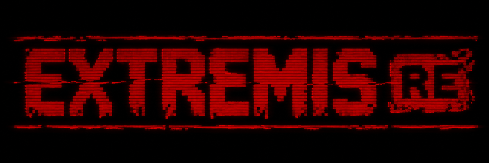

<div align="center">



<br>

[](https://isocpp.org/)
[](https://www.libsdl.org/)


</div>

---

## ☣️ What is EXTREMIS RE?

**Extremis RE** is an independent, unofficial **C++17 / SDL3 reconstruction and source port of *In Extremis* (1993)**, an obscure first-person shooter with a uniquely unsettling science-fiction atmosphere.

We're rebuilding its behaviour from the original DOS executable and game data: the maps, enemies, weapons, survival systems, interfaces, strange little rules, and all the other things that make it *In Extremis*.

This is **not a modern remake**. The mission is to make the original game playable on modern systems while preserving its identity, not replacing it.

## 🧪 Resurrection progress

**Estimated project completion: ~40%** — a rough development assessment, **not** a measurement of how many levels have been fully tested or a percentage derived from CTest.

**🟩🟩🟩🟩🟩🟩🟩🟩⬛⬛⬛⬛⬛⬛⬛⬛⬛⬛⬛⬛ &nbsp; ~40%**

*The core engine and much of the first playable gameplay loop exist. Campaign-wide fidelity, original presentation, save/load, and verification of the full 30-level experience remain substantial work.*

### Mission objectives

| Objective | Status | What's left to accomplish |
|:--|:--:|:--|
| **Read original data and all 30 level definitions** | ✅ Working | Validate later-level content and special cases in actual play |
| **Rebuild the 3D rendering pipeline** | 🟡 Refining | Resolve elevator texture leakage, visual edge cases, aspect ratios and performance |
| **Player movement, collisions and survival** | 🟡 Refining | Verify original timing, oxygen/health behaviour and remaining collision edge cases |
| **Doors, security, terminals and elevators** | 🟡 Refining | Finish door timing, special interactions and all cross-level transitions |
| **Weapons, projectiles and enemy behaviour** | 🟡 Refining | Verify each monster bank, special attacks and late-game behaviour against DOS |
| **Decorative sprites, animation and collisions** | 🟡 Refining | Validate animation conditions and timing across every bank and level |
| **Original HUD, motion detector, map and inventory** | 🟡 Refining | Restore remaining interface details and interaction edge cases |
| **Sound effects and environmental audio** | 🟡 Refining | Check missing cues, sound timing and original ambient behaviour |
| **Original menus, scenes, death and ending** | 🔴 Incomplete | Recreate the original sequences, including the full-screen green death effect |
| **Save / load and full game-state restoration** | 🔴 Incomplete | Implement and test the complete persistence cycle |
| **Complete all 30 levels** | 🔴 Unverified | Play through every level; validate secrets, events, transitions and final triggers |
| **Cross-platform release quality** | 🔴 Pending | Thorough macOS/Windows testing, packaging and release documentation |

**Legend:** ✅ core functionality working · 🟡 implemented but still being verified/refined · 🔴 substantial work remains.

Progress is updated manually as systems are **implemented and validated**, not just when a new file compiles.

---

## 🟢 What's already alive?

The port already has substantial working systems, including:

- First-person rendering with textured walls, floors, ceilings and sprites.
- Original level and resource-bank loading, including the game's 30-level structure.
- Player movement, collision, health and oxygen mechanics.
- Doors, card readers, security codes, elevators and other interactions.
- Inventory, weapons, projectiles and combat.
- Enemy AI, damage, death, navigation and collisions.
- Decorative **OBJET** sprites, animation and collision handling.
- Original-style 320×200 HUD, motion detector and map interfaces.
- Original audio resource decoding and gameplay sound effects.
- Automated regression tests and technical documentation rooted in reverse engineering.
- An **Extremis RE** startup sequence with ECG animation, CRT interference and the original `CASQUE.SPR` font.

**Important:** *Working* does **not** mean every feature has been verified in all 30 levels. This is an active reconstruction, not a finished campaign release.

## 💻 Build and run

### Requirements

- CMake **3.16+**
- A C++17-capable compiler
- **SDL3 3.2+** development libraries
- Your **own legally obtained copy** of the original *In Extremis* game data

```sh
cmake -S . -B build/release -DCMAKE_BUILD_TYPE=Release
cmake --build build/release -j4
ctest --test-dir build/release --output-on-failure
```

Run the port, passing the path to the original **`GAME.LAB`** file:

```sh
./build/release/InExtremisPort "/path/to/In_Extremis/GAME.LAB"
```

The required original resources must also be available in the expected **`DATA`** directory alongside the game. **No copyrighted original game assets are included in this repository.**

Current development and testing are focused primarily on macOS; other platforms require additional validation.

## 📟 Technical field guide

The reconstruction is driven by analysis of the original executable, original assets, observations of the DOS game and targeted tests. The documentation distinguishes **confirmed** behaviour, **adaptations**, and **open questions**.

Start with the [technical field guide](docs/README.md), or jump straight into:

| System | Research notes |
|:--|:--|
| 🧬 Level data and sectors | [GAME.LAB and levels](docs/systems/levels.md) |
| 👾 Creatures and combat | [Enemies](docs/systems/enemies.md) · [Weapons](docs/systems/weapons.md) |
| 🏭 The station | [Doors and elevators](docs/systems/world.md) · [Decorations](docs/systems/decorations.md) |
| 🫁 Staying alive | [Player and survival](docs/systems/player.md) · [Inventory](docs/systems/items.md) |
| 📺 Original interfaces | [HUD, map and terminals](docs/systems/interfaces.md) |
| 🔊 Sound and graphics | [Audio](docs/systems/audio.md) · [Rendering](docs/systems/rendering.md) |
| ⚠️ What still differs | [Known differences](docs/reference/known-differences.md) |

Some reference pages describe an earlier code snapshot; verify unresolved details against the latest source and tests.

## 🔬 How it's being reconstructed

**Reverse engineering · Ghidra · Original DOS data · Hand-written C++ · AI-assisted development · Testing · Patience.**

The goal is **preservation through understanding**: no imaginary mechanics, no pretending an approximation is verified, and no unnecessary modernization just because something old looks strange.

## 🧟 Credits and rights

**Port, reverse engineering and project maintenance:** **Carlos de la Barrera Pérez (xXNukem)**.

This is an **independent, unofficial, non-commercial preservation project**. *In Extremis* and its original intellectual property belong to their respective rights holders. The original commercial game and its assets are **not distributed** here.

The source-code license is specified in [LICENSE](LICENSE); attribution information is in [NOTICE](NOTICE).

Bug reports, reproducible tests and corrections to the reverse-engineering notes are welcome. Please do **not** include original copyrighted game assets in issues or pull requests.
