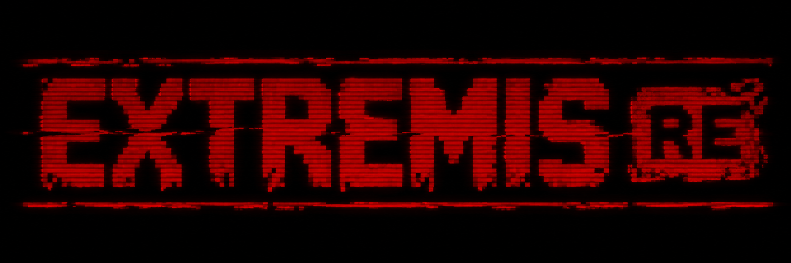

<div align="center">



<br>

[](https://isocpp.org/)
[](https://www.libsdl.org/)


</div>

---

<div align="center">

## Support the project

If you'd like to support development:

<a href="https://ko-fi.com/xxnukem"></a>

**[ko-fi.com/xxnukem](https://ko-fi.com/xxnukem)**

</div>

---

## About Extremis RE

**Extremis RE** is an independent, unofficial C++17/SDL3 reconstruction and port of *In Extremis* (1993) for modern systems.

The project uses the original DOS executable and game data as references for gameplay, rendering, audio and interface behaviour. It aims to preserve the original game rather than redesign it. Players must supply their own game files.

## Development progress

**Estimated completion: ~65%** (manual estimate, not a measured percentage of code or completed levels).

**🟩🟩🟩🟩🟩🟩🟩🟩🟩🟩🟩🟩🟩⬛⬛⬛⬛⬛⬛⬛ &nbsp; 65%**

The core engine, major original cinematics, level 22 events and a navigable port menu prototype are implemented. Save/load, functional menu settings, campaign-wide verification and release testing are still outstanding.

### Feature status

| Area | Status | Notes |
|:--|:--|:--|
| Original game data and 30 level definitions | Implemented | All level definitions can be loaded; later levels require gameplay verification |
| 3D renderer | Functional | Textured walls, floors, ceilings and sprites; visual issues, aspect ratios and performance remain |
| Player controls and survival | Functional | Movement, health, oxygen, running and collision; timing and edge cases need further verification |
| Doors, terminals and elevators | Functional | Opening/closing, security, interactions and level transfers; special cases remain to be tested |
| Weapons, projectiles and enemies | Functional | Combat and enemy behaviour implemented; all banks and later-game encounters are not fully verified |
| Decorative objects | Functional | Sprite animations and collision implemented; some timing and bank-specific behaviour remain |
| HUD, inventory and map | Functional | Original 320×200 layout and interfaces; remaining interaction details need checking |
| Sound effects | Functional | Original audio resources and gameplay cues; ambient audio and some timing need verification |
| Original startup presentation | Implemented | Blue Sphere, Présente, title, four credits and all 12 PSEQ stages; timing differences remain |
| Player death and GAME OVER | Implemented | Health, oxygen and self-destruction death sequences, GAME OVER and menu return; some timing is adapted |
| Original main menu | Partial | Returns after GAME OVER and victory; original startup integration and password continuation are unfinished |
| Port main menu and OPTIONS | Prototype | Startup and in-game menu with navigable VIDEO, AUDIO, CONTROLS and LANGUAGE screens; settings are previews and LOAD GAME is pending |
| Final cinematic | Implemented | Original FSEQ sequence, connected to MONS9 defeat; visually validated, full-campaign trigger still to be verified |
| Inter-level elevator cinematics | Implemented | Four original movement variants integrated and visually validated; DOS timing comparison pending |
| Level 22 self-destruction | Implemented | 16 security conditions, countdown, alarms and explosion death; persistence across levels verified |
| Level 22 shuttle evacuation | Implemented | Boarding, access checks, full travel sequence and level 23 arrival; visually validated |
| Level 22 communication | Implemented | Door-triggered YES/NO prompt and seven narrative pages; visually validated |
| Original in-game text | Needs review | Translate remaining French to English and proofread existing English messages |
| Save/load | Not implemented | Full game-state persistence and restoration are pending |
| Full campaign | Not verified | All 30 levels require end-to-end testing, including events, transitions and the ending |
| Platform support and releases | In progress | Development and manual testing primarily on macOS; Windows and release packaging need validation |

**Latest reported Debug test result (16 November 2026): 36/36 CTest tests passed.** This does not mean all levels or DOS behaviour have been verified.

### Implemented so far

- Original level, texture, sprite and audio data loading.
- First-person renderer with floor and ceiling textures.
- Player movement, survival systems, weapons, projectiles and enemy AI.
- Doors, readers, terminals, elevators, inventory, HUD and map.
- Decorative sprite animation and collision handling.
- Custom Extremis RE startup presentation.
- Navigable port menu and OPTIONS prototype, with original DOS sound effects for entering, leaving and changing preview values.
- Original Blue Sphere presentation, In Extremis title, credits and PSEQ introduction.
- Original health/oxygen death presentations, GAME OVER and final FSEQ cinematic.
- Original four-variant elevator transitions and level 22 shuttle evacuation to level 23.
- Level 22 autodestruction countdown, explosion death and seven-page communication event.
- Automated tests and technical notes based on the original executable.

### Main work remaining

- Save/load and full game-state restoration.
- Implement LOAD GAME, make port OPTIONS settings functional, and finish original menu/password integration.
- Translate remaining French dialogue and correct spelling and grammar in English text.
- Fidelity checks for animation timing, audio and specific original effects.
- Remaining gameplay, collision and rendering edge cases.
- Full playthrough and validation of all 30 levels, including the final encounter.
- Windows testing, performance work and release packaging.

## Build and run

### Requirements

- CMake **3.16+**
- A C++17-capable compiler
- **SDL3 3.2+** development libraries
- Your own legally obtained copy of *In Extremis*

```sh
cmake -S . -B build/release -DCMAKE_BUILD_TYPE=Release
cmake --build build/release -j4
ctest --test-dir build/release --output-on-failure
```

Start the game with the path to the original `GAME.LAB`:

```sh
./build/release/InExtremisPort "/path/to/In_Extremis/GAME.LAB"
```

The original `DATA` directory must be alongside `GAME.LAB`. Original game assets are **not** included in this repository.

Development and testing are currently focused on macOS. Windows support has not yet been fully validated.

## Technical documentation

The [technical field guide](docs/README.md) describes the file formats, implementation and reverse-engineering findings. Confirmed original behaviour, port-specific adaptations and unresolved questions are distinguished in the notes.

| System | Documentation |
|:--|:--|
| Levels and sectors | [Levels](docs/systems/levels.md) |
| Enemies and weapons | [Enemies](docs/systems/enemies.md) · [Weapons](docs/systems/weapons.md) |
| Doors, elevators and objects | [World](docs/systems/world.md) · [Decorations](docs/systems/decorations.md) |
| Player and inventory | [Player](docs/systems/player.md) · [Items](docs/systems/items.md) |
| HUD, map and terminals | [Interfaces](docs/systems/interfaces.md) |
| Audio and graphics | [Audio](docs/systems/audio.md) · [Rendering](docs/systems/rendering.md) |
| Original introduction | [Introduction research](docs/reference/exe/introduction.md) |
| Death sequences | [Death sequence research](docs/reference/exe/player-death.md) |
| Known differences | [Technical limitations](docs/reference/known-differences.md) |

Development uses Ghidra, original DOS data, C++ implementation, automated tests and manual gameplay checks.

## Credits and rights

**Port, reverse engineering and maintenance:** Carlos de la Barrera Pérez (xXNukem).

Extremis RE is an independent, unofficial, non-commercial project. *In Extremis* and its original intellectual property belong to their respective rights holders. The original game and its assets are not distributed here.

The source-code license is in [LICENSE](LICENSE); attribution information is in [NOTICE](NOTICE).

Bug reports and corrections to the technical documentation are welcome. Please do not upload copyrighted original game assets to issues or pull requests.
